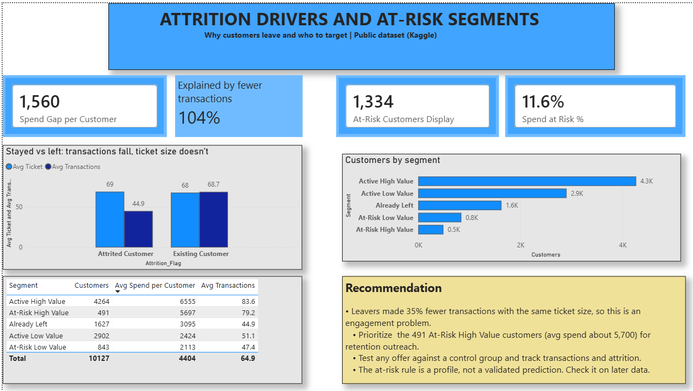

# Credit Card Portfolio Analysis

Portfolio performance, attrition drivers and at-risk customer segments for a credit card portfolio, built with Python, MySQL and Power BI.

## Business question

Which card members drive spend, why do some disengage and leave, and which current customers should a retention team target first?

## Data

- Source: Kaggle "Credit Card Customers" dataset (BankChurners), a public dataset. It is not real company data.
- 10,127 customers, 21 original columns: demographics, card category, tenure, inactivity, credit limit, utilisation, spend, transaction counts and Q4 vs Q1 changes.
- Limitation: a single snapshot with no monthly history, so the analysis compares groups rather than trends and shows association, not causation.

## Tools

Python (Pandas, NumPy) · MySQL (SQLAlchemy, window functions) · Power BI (DAX measures) · Excel

## Method

1. **Cleaning (Python):** dropped two model-output columns, checked data types and missing values (none), checked duplicate customer IDs (none), kept "Unknown" categories as their own group (1,112 customers with unknown income), and created helper columns for average ticket, age band and an attrition flag.
2. **Portfolio KPIs (SQL):** loaded the cleaned data into MySQL and calculated KPIs overall and by card category, income band and age band using GROUP BY, plus window functions (share of spend, spend quartiles, top spenders per card).
3. **Decomposition:** split the spend gap between customers who stayed and customers who left into transaction frequency and average ticket size.
4. **Early-warning rule:** tested 12 threshold combinations on the Q4 vs Q1 change in transaction count and months inactive, and chose the rule with the best balance of lift and coverage.
5. **Segmentation:** grouped customers into Active High Value, Active Low Value, At-Risk High Value, At-Risk Low Value and Already Left.
6. **Dashboard (Power BI):** two pages, a portfolio overview and an attrition drivers and segments page.

## Key findings

- **Attrition:** 16.07% of customers left (1,627 of 10,127).
- **Age:** attrition is highest in the 40 to 49 and 50 to 59 bands (about 16.9%), which are also the two largest groups.
- **Income:** attrition only ranges from 13.5% to 17.3% across income bands, so income is not a strong driver.
- **Card mix:** Blue cards are 93% of customers but 89.4% of spend, so premium cards contribute more spend than their customer share.
- **Why spend is lower for leavers:** customers who left spent 1,560 less on average. They made about 35% fewer transactions (44.9 vs 68.7) while their average ticket was the same (68.9 vs 67.8). Transaction frequency explains 104% of the spend gap and ticket size -4%, so this is an engagement problem, not a pricing problem.
- **Early-warning rule:** customers whose Q4 transaction count fell below 0.6 of Q1 and who were inactive for 2 or more months had 41.4% attrition, a lift of 2.6x over the 16.1% average. The rule flags about 22% of customers and catches 58% of all leavers.
- **Exposure:** 1,334 current customers match the rule, holding 11.6% of current-customer spend. The 491 At-Risk High Value customers spend about 5,697 each, close to the Active High Value average of 6,555.

## Recommendations

- Treat attrition as an engagement problem and focus on increasing transaction frequency.
- Prioritise the 491 At-Risk High Value customers for retention outreach.
- Test any offer against a control group and measure transactions and attrition.
- Validate the early-warning rule on a later period before using it in production, because it was chosen on the same data it was tested on.

## Dashboard

### Page 1: Portfolio overview


### Page 2: Attrition drivers and at-risk segments


## Project structure

```
card-portfolio-analysis/
  data/        raw and cleaned CSV files
  notebooks/   Jupyter notebook: cleaning, decomposition, rule testing, segmentation
  sql/         MySQL queries: KPIs, window functions, decomposition
  dashboard/   Power BI file and screenshots
  README.md
```

## How to run

1. Download `BankChurners.csv` from Kaggle into `data/`.
2. Run `notebooks/01_clean_and_explore.ipynb` to create the cleaned and segmented CSV files.
3. Create a MySQL database called `card_portfolio`, add your own MySQL password in the notebook connection cell, and load the cleaned data.
4. Run the queries in `sql/01_kpis.sql`.
5. Open `dashboard/card_portfolio.pbix` in Power BI Desktop.

## Author

Ankit Kumar